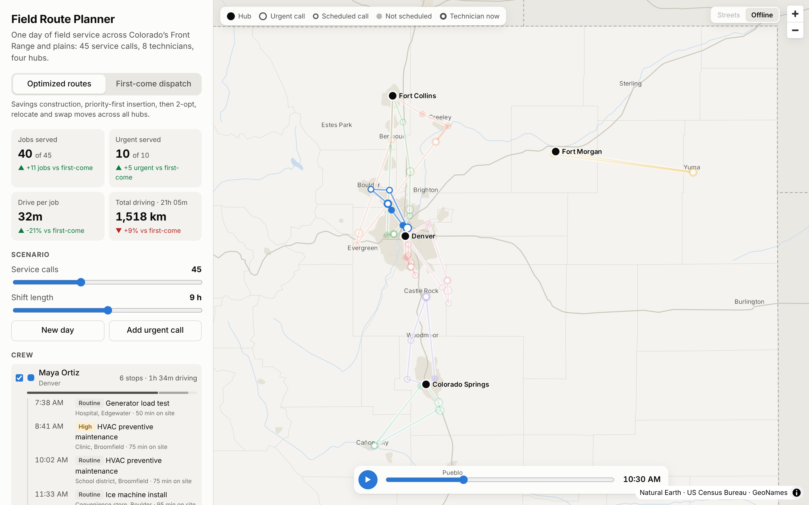

# Field Route Planner

Plan one day of field service across Colorado’s Front Range and eastern plains. Eight technicians start from four hubs, a few dozen service calls come in, and the planner builds each technician’s route for the day. Everything runs in the browser.



**Live demo: [field-route-planner-y3px.vercel.app](https://field-route-planner-y3px.vercel.app/)**

## What it does

- **Optimizes multi-depot routes** for a crew with shift limits, serving urgent calls first and then cutting drive time.
- **Compares against first-come dispatch**, the way a busy dispatcher works by hand: calls in arrival order, each to the nearest hub’s least-busy technician. The metric cards show the difference in jobs served, urgent calls served, and drive time per job.
- **Plays back the day.** Press play to watch technicians drive their routes. Completed calls fill in with the technician’s color.
- **Takes urgent calls.** Click **Add urgent call**, then click the map. The new call is routed right away, displacing routine work if it has to.
- **Changes the scenario**: the number of calls, shift length, a new day, and which technicians are on shift.
- **Works without tile servers.** The default basemap is OpenFreeMap. If it can’t load, the app switches to a bundled basemap built from Natural Earth and US Census data, so the demo never shows a blank map.
- Light and dark themes, keyboard-accessible controls, and a stacked layout on phones.

## How the optimizer works

The solver is in [`src/lib/solver.ts`](src/lib/solver.ts), about 400 lines of TypeScript with no dependencies. It plans a 45-call day in a few milliseconds.

1. **Cluster.** Each call goes to the nearest hub with someone on shift.
2. **Construct.** Clarke-Wright savings builds routes per hub that respect the shift length. Each technician takes the most valuable route, weighted by priority (urgent 100, high 10, routine 1).
3. **Insert.** Calls left over are inserted at the cheapest feasible position in any route, across hubs, highest priority first.
4. **Exchange by priority.** If an urgent call still doesn’t fit, it replaces a lower-priority call when the swap is feasible.
5. **Improve.** Local search with 2-opt within routes, plus relocate and swap moves between routes, until no move shortens total drive time.

Steps 3 to 5 repeat a few times, since shorter routes make room for more calls.

Travel time is straight-line distance times a road-circuity factor of 1.3 at 72 km/h, so the demo needs no routing API. To use real road times, replace the matrix in `buildProblem` with one from OSRM or Valhalla.

The tests in [`src/lib/solver.test.ts`](src/lib/solver.test.ts) check that every route fits in the shift, every call is either scheduled once or listed as unscheduled, routes start and end at the technician’s hub, and the optimizer beats the baseline on drive time per job across several seeds.

## Data

| Data | Source | License |
| --- | --- | --- |
| Towns and hub locations | [GeoNames](https://www.geonames.org/) via [`all-the-cities`](https://github.com/zeke/all-the-cities) | CC BY 4.0 |
| Roads, urban areas, lakes, rivers | [Natural Earth](https://www.naturalearthdata.com/) 1:10m | Public domain |
| State and county lines | US Census Bureau via [`us-atlas`](https://github.com/topojson/us-atlas) | Public domain |
| Street basemap | [OpenFreeMap](https://openfreemap.org/), © OpenStreetMap contributors | ODbL |

Service calls, customers, and technicians are synthetic. They are generated from a seed on top of the real town locations, so a given seed always produces the same day.

To rebuild the bundled data, download `ne_10m_roads`, `ne_10m_urban_areas`, `ne_10m_lakes`, and `ne_10m_rivers_lake_centerlines` GeoJSON from [natural-earth-vector](https://github.com/nvkelso/natural-earth-vector/tree/master/geojson) into a folder and run `npm run data -- <folder>`.

## Stack

Next.js 16 (static export) · React 19 · TypeScript · deck.gl 9 (`PathLayer`, `TripsLayer`, `ScatterplotLayer`, `TextLayer`) · MapLibre GL 5 via react-map-gl · Vitest · ESLint

## Run it locally

```bash
npm install
npm run dev        # http://localhost:3000
npm test           # solver tests
npm run build      # static site in out/
```

## Deploy

The build is a static site in `out/`, so any static host works.

- **Vercel:** import the repository. The defaults work as is.
- **GitHub Pages or another subpath:** set `NEXT_PUBLIC_BASE_PATH=/field-route-planner` before `npm run build`.

## Project layout

```
src/
  app/                 Next.js app shell and global styles
  components/
    Planner.tsx        Sidebar, metrics, crew list, itineraries, time controls
    MapView.tsx        MapLibre map with a deck.gl overlay and basemap fallback
  lib/
    solver.ts          Route optimizer and first-come baseline
    scenario.ts        Hubs, crew, and seeded service-call generator
    geo.ts             Distance, seeded random numbers, time formatting
    theme.ts           Route palette and map colors for light and dark
  data/towns.json      Service-area towns (GeoNames)
public/data/basemap.json  Offline basemap layers
scripts/build-data.mjs    Rebuilds the two data files
```

## Ideas for later

- Time windows for appointments, and technician skills matched to work types
- Real road-network travel times and route geometry
- Run the solver in a Web Worker for much larger days

---

Built by [Cole Hart](https://www.linkedin.com/in/colehart-io/).
